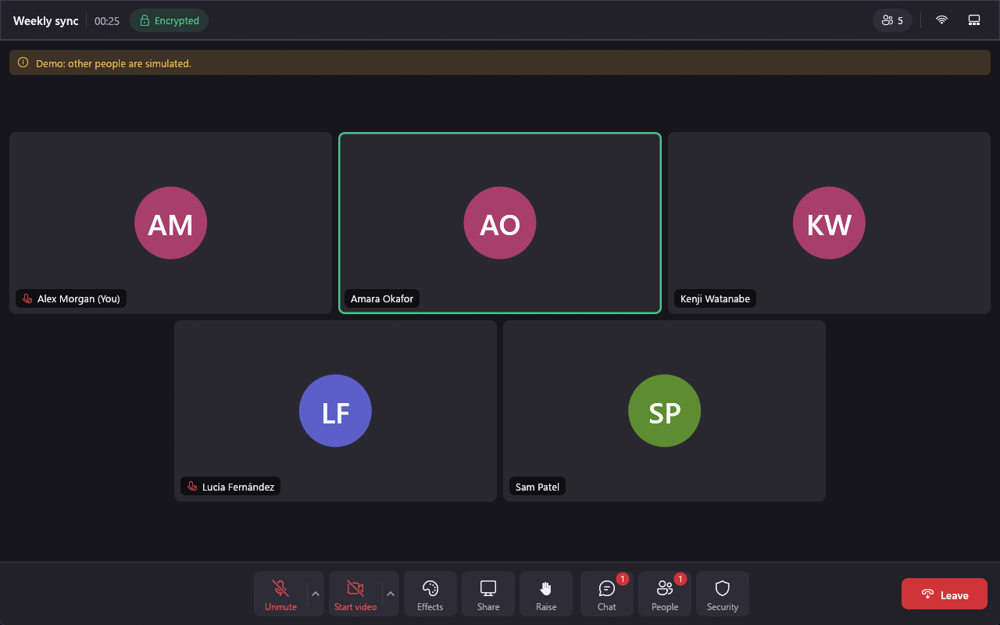
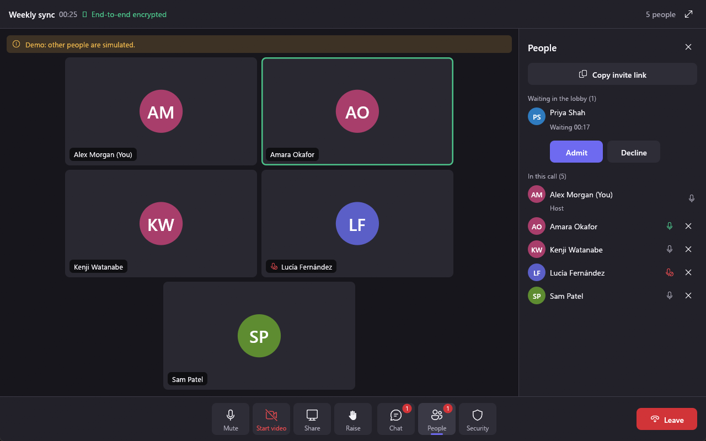
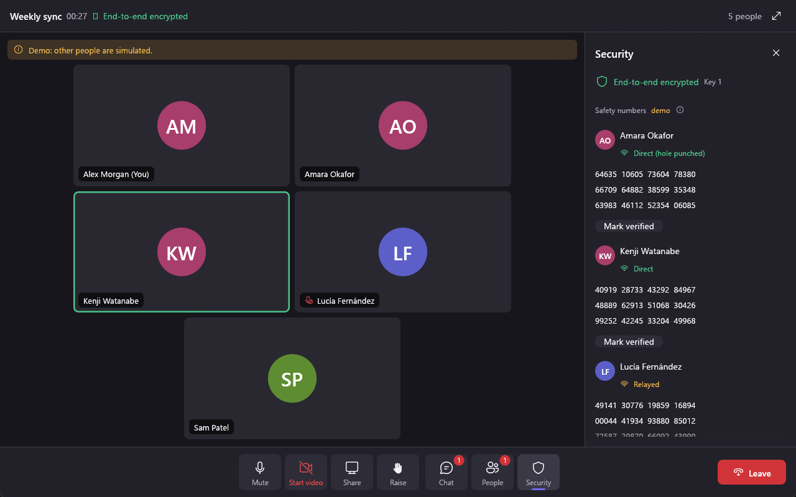
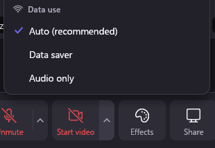
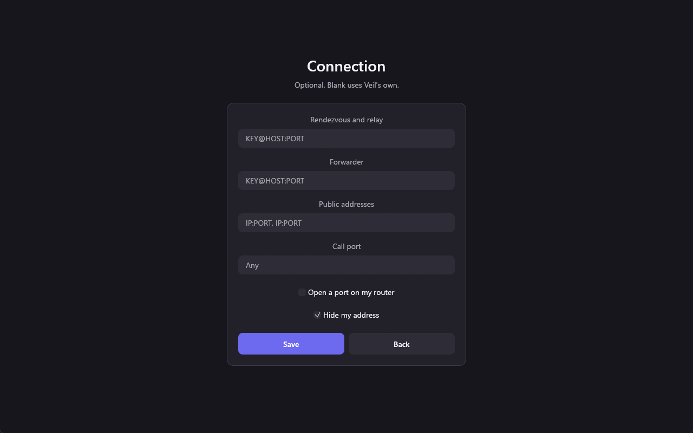

<div align="center">



# Veil

**Private video calls, encrypted end to end. Peer to peer, in Rust.**

[](https://github.com/Jeremy8776/veil/actions/workflows/ci.yml)
[](https://github.com/Jeremy8776/veil/releases)
[](#licence)




</div>

Veil is a video call app with no company in the middle. Your device makes the keys, the people
in the call hold them, and nothing else can read the call: not a relay, not a forwarder, not
us. Servers are optional: a participant's computer or a `veil-node` you choose can carry a
call. The desktop app and node are built for Windows, macOS and Linux.

> [!WARNING]
> Veil is early and has had no independent security audit. Do not trust it with anything that
> matters yet. [docs/TRANSPARENCY.md](docs/TRANSPARENCY.md) lists what it does not protect.

## Features

- **End-to-end encrypted.** Video, sound, names and chat are sealed on your device. Group keys
  use MLS (RFC 9420) and change every time someone joins or leaves.
- **Peer to peer.** Calls connect directly, punch through home routers, or fall back to a relay.
  Bigger calls can use a forwarder that limits video layers to the size each person requests.
- **You decide who joins.** Invites are signed and single use. The host admits or declines each
  person from the lobby.
- **Check who you are talking to.** Each pair of people has a safety number. Swap codes once
  through an app you already trust, or compare them by hand. In a group, everyone posts one
  group code in a trusted external chat and pastes the others' codes. Windows remembers
  verified keys; Linux and macOS currently keep them only until Veil closes.
- **Share your screen.** Share a screen, an app or part of one, sealed end to end like your
  camera. Filters and background blur work before and during a call.
- **Clearer sound.** Local noise suppression cleans your microphone by default, with an
  option to clean sound from others too. No sound is sent away for processing.
- **Chat and lobby alerts.** Colour emoji and reactions in chat; notifications when someone
  waits in your lobby while you are in another app. Raised hands reach everyone in the call.
- **No accounts, no telemetry.** Veil sends nothing to its authors. Every server address comes
  from you.
- **Try it alone.** "Demo call" on the home screen shows a simulated call with no network.

| Home | Lobby and people | Safety numbers |
|---|---|---|
|  |  |  |

Screenshots are from the demo call. The people in them are simulated.

### On mobile data or a slow network

- **Data use.** Pick it before you join, or from the arrow beside the camera button during a
  call. Auto (recommended) sends the best picture the link allows. Data saver sends one small
  picture at about 150 kbit/s and sound at 16 kbit/s. Audio only turns your camera off and
  sends sound at 16 kbit/s. Windows keeps your choice between runs; standard Linux/macOS
  runs currently keep settings only while the app stays open.
  Audio only still receives others' video, and screen sharing remains available. Through a
  forwarder it requests the smallest video layer; mesh calls still receive every sent layer.
- **Hide my address.** In Connection on the home screen. When you join a call, Veil reaches
  everyone through the call's relay only, so the others never learn your IP address. Off by
  default. [docs/TRANSPARENCY.md](docs/TRANSPARENCY.md) says what it does not hide.

| Data use | Hide my address |
|---|---|
|  |  |

## Download

Builds are on the [latest release](https://github.com/Jeremy8776/veil/releases/latest).
For 0.1.13, update every participant and `veil-node` together: older releases cannot use
the new call-port handshake and control/forwarder messages. Copy fresh invitations afterwards.

| System | File | Notes |
|---|---|---|
| Windows 10 and 11 | `veil-<version>-windows-x64.msi` | Installs for all users and lets calls through the firewall. Windows asks for permission once |
| | `veil-<version>-windows-x64-portable.zip` | Unzip anywhere, no admin rights. The host's "Allow guests" button adds the firewall rule |
| macOS 11 and later | `veil-<version>-macos-universal.dmg` | Drag Veil to Applications. Apple Silicon and Intel |
| Linux x64 | `.AppImage`, `.deb`, `.rpm` or `.tar.gz` | glibc 2.39 or later (Ubuntu 24.04, Debian 13, Fedora 40) |

To check a download by hand: its SHA-256 (`Get-FileHash` on Windows, `shasum -a 256` on
macOS, `sha256sum` on Linux) must match its line in `SHA256SUMS.txt`.

The app tells you when a newer release is out. Installed from the MSI, the DMG or the
AppImage, it can also install it for you: it checks the release's signature first (see
[docs/TRANSPARENCY.md](docs/TRANSPARENCY.md)). Other copies link to the release page.

Until the Windows files are signed, Windows SmartScreen says "unknown publisher" (choose
**More info**, then **Run anyway**). macOS builds are not notarised yet, so macOS asks you to
allow Veil in System Settings, Privacy and Security.

### Code signing policy

Free code signing provided by [SignPath.io](https://about.signpath.io), certificate by
[SignPath Foundation](https://signpath.org) (not yet active). Who builds,
reviews and approves each signed release, and Veil's privacy statement:
[docs/CODE_SIGNING.md](docs/CODE_SIGNING.md).

## How a call works

1. The host starts a call and copies the invite link.
2. A guest pastes the link and waits in the lobby.
3. The host admits them. Their devices agree a new group key that only members hold.
4. Video and sound go straight between devices, or through a relay or forwarder that only sees
   sealed packets.

[docs/ARCHITECTURE.md](docs/ARCHITECTURE.md) has the full design.
For a first call, device choices and connection problems, see
[Getting started](docs/GETTING_STARTED.md).

The current desktop camera path is capped at 1080p; screen sharing at 1920 pixels on its
longest side. 4K60, forwarder cascades and enterprise identity/policy are future work.

## The pieces

| Crate | What it does |
|---|---|
| [`veil-app`](crates/veil-app) | The desktop app |
| [`veil-security`](crates/veil-security) | Device keys, safety numbers, signed invites, per-frame encryption |
| [`veil-group`](crates/veil-group) | MLS group keys and the host's lobby |
| [`veil-net`](crates/veil-net) | QUIC links pinned to device keys |
| [`veil-rendezvous`](crates/veil-rendezvous) | Address discovery, hole punching and relay |
| [`veil-forward`](crates/veil-forward) | The forwarder: receive each stream once, send each person what they need |
| [`veil-topology`](crates/veil-topology) | Picks a mesh or forwarded layout that fits everyone's bandwidth |
| [`veil-call`](crates/veil-call) | Call sessions: links, lobby, keys and routes together |
| [`veil-media`](crates/veil-media) | Camera, screen capture, H.264, Opus and local effects on Windows, Linux and macOS |
| [`veil-node`](crates/veil-node) | One server binary for any role: rendezvous, relay, forwarder |
| [`veil-portmap`](crates/veil-portmap) | Optional, temporary router port mappings and IPv6 pinholes |
| [`veil-probe`](crates/veil-probe) | A camera-free test call between real networks |

## Build from source

You need Rust 1.98.1. Windows, Linux and macOS builds are supported; Linux needs the
development packages listed in [CI](.github/workflows/ci.yml). Real-device coverage varies
by platform: see [TRANSPARENCY.md](docs/TRANSPARENCY.md#7-not-yet-tested).

```bash
cargo build -p veil-app --release
```

The app is then `target/release/veil-app.exe` on Windows, or `target/release/veil-app` on
Linux and macOS. To run tests and check dependency licences:

```bash
cargo test -p veil-security -p veil-topology
python tools/licences.py --check
```

To work on the interface, this rebuilds and reopens Veil in its demo call whenever you save a
change:

```bash
powershell -ExecutionPolicy Bypass -File tools/dev-ui.ps1
```

## Run your own server

`veil-node` can be your rendezvous, relay and forwarder, so calls never touch anyone else's
machine. Copy [`veil-node.example.toml`](crates/veil-node/veil-node.example.toml), edit it,
and run `veil-node veil-node.toml`. Put its public `key@host:port` addresses in the desktop
app's Connection settings. See [Self-hosting](docs/SELF_HOSTING.md) for host allow-lists,
UDP ports, IPv6 and the difference between listening and public addresses.

## Documents

- [ARCHITECTURE.md](docs/ARCHITECTURE.md): the design, including the planned parts.
- [GETTING_STARTED.md](docs/GETTING_STARTED.md): make a first call and resolve common problems.
- [SELF_HOSTING.md](docs/SELF_HOSTING.md): run a node for chosen hosts.
- [RELEASING.md](docs/RELEASING.md): versioning, packages and release verification.
- [TRANSPARENCY.md](docs/TRANSPARENCY.md): dependencies, what other parties can see, known leaks.
- [DEPENDENCIES.md](docs/DEPENDENCIES.md): every third-party crate and its licence.
- [HANDOFF.md](docs/HANDOFF.md): what is done and what is next.

## Contributing

Issues and pull requests are welcome. Read [CONTRIBUTING.md](CONTRIBUTING.md) first, and follow
the [code of conduct](CODE_OF_CONDUCT.md).

## Security

Report a hole privately through the repository's Security tab, not in a public issue.
See [SECURITY.md](SECURITY.md).

## Licence

Licensed under either of [Apache License, Version 2.0](LICENSE-APACHE) or [MIT licence](LICENSE-MIT),
at your option.

Unless you explicitly state otherwise, any contribution you intentionally submit for inclusion in
Veil, as defined in the Apache-2.0 licence, is dual licensed as above, without any additional
terms or conditions.
