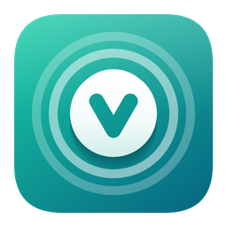
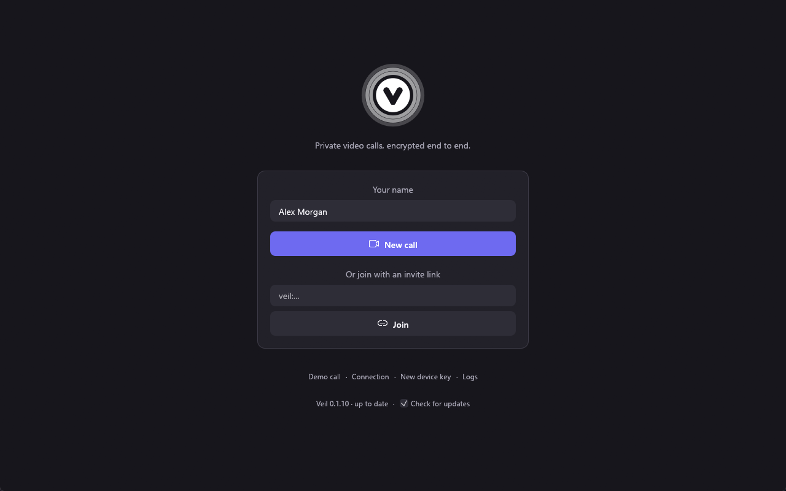

<div align="center">



# Veil

**Private video calls, encrypted end to end. Peer to peer, in Rust.**

[](https://github.com/Jeremy8776/veil/actions/workflows/ci.yml)
[](https://github.com/Jeremy8776/veil/releases)
[](#licence)


</div>

Veil is a video call app with no company in the middle. Your device makes the keys, the people
in the call hold them, and nothing else can read the call: not a relay, not a forwarder, not
us. Servers are optional. Any participant, a box you run, or an enterprise cluster can carry a
call, and none of them can see inside it.

> [!WARNING]
> Veil is early and has had no independent security audit. Do not trust it with anything that
> matters yet. [docs/TRANSPARENCY.md](docs/TRANSPARENCY.md) lists what it does not protect.

## Features

- **End-to-end encrypted.** Video, sound, names and chat are sealed on your device. Group keys
  use MLS (RFC 9420) and change every time someone joins or leaves.
- **Peer to peer.** Calls connect directly, punch through home routers, or fall back to a relay.
  Bigger calls can use a forwarder that sends each person only the video size they need.
- **You decide who joins.** Invites are signed and single use. The host admits or declines each
  person from the lobby.
- **Check who you are talking to.** Each pair of people has a safety number. Compare it out
  loud once, mark them verified, and it still holds next call.
- **No accounts, no telemetry.** Veil sends nothing to its authors. Every server address comes
  from you.
- **Try it alone.** "Demo call" on the home screen shows a simulated call with no network.

| Home | Lobby and people | Safety numbers |
|---|---|---|
|  |  |  |

Screenshots are from the demo call. The people in them are simulated.

## Download

Builds are on the [latest release](https://github.com/Jeremy8776/veil/releases/latest).

| System | File | Notes |
|---|---|---|
| Windows 10 and 11 | `veil-<version>-windows-x64.msi` | Installs for all users and lets calls through the firewall. Windows asks for permission once |
| | `veil-<version>-windows-x64-portable.zip` | Unzip anywhere, no admin rights. The host's "Allow guests" button adds the firewall rule |
| macOS 11 and later | `veil-<version>-macos-universal.dmg` | Drag Veil to Applications. Apple Silicon and Intel |
| Linux x64 | `.AppImage`, `.deb`, `.rpm` or `.tar.gz` | glibc 2.35 or later (Ubuntu 22.04, Debian 12, Fedora 36) |

To check a download by hand: its SHA-256 (`Get-FileHash` on Windows, `shasum -a 256` on
macOS, `sha256sum` on Linux) must match its line in `SHA256SUMS.txt`.

The app tells you when a newer release is out. Installed from the MSI, the DMG or the
AppImage, it can also install it for you: it checks the release's signature first (see
[docs/TRANSPARENCY.md](docs/TRANSPARENCY.md)). Other copies link to the release page.

Until the release workflow has signing certificates, Windows SmartScreen says "unknown
publisher" (choose **More info**, then **Run anyway**) and macOS asks you to allow Veil in
System Settings, Privacy and Security.

## How a call works

1. The host starts a call and copies the invite link.
2. A guest pastes the link and waits in the lobby.
3. The host admits them. Their devices agree a new group key that only members hold.
4. Video and sound go straight between devices, or through a relay or forwarder that only sees
   sealed packets.

[docs/ARCHITECTURE.md](docs/ARCHITECTURE.md) has the full design.

## The pieces

| Crate | What it does |
|---|---|
| [`veil-app`](crates/veil-app) | The desktop app |
| [`veil-security`](crates/veil-security) | Device keys, safety numbers, signed invites, per-frame encryption |
| [`veil-group`](crates/veil-group) | MLS group keys and the host's lobby |
| [`veil-net`](crates/veil-net) | QUIC links pinned to device keys |
| [`veil-rendezvous`](crates/veil-rendezvous) | Address discovery, hole punching and relay |
| [`veil-forward`](crates/veil-forward) | The forwarder: receive each stream once, send each person what they need |
| [`veil-topology`](crates/veil-topology) | Picks a mesh or forwarded layout that fits everyone's bandwidth |
| [`veil-call`](crates/veil-call) | Call sessions: links, lobby, keys and routes together |
| [`veil-media`](crates/veil-media) | Camera, H.264 and Opus on Windows |
| [`veil-node`](crates/veil-node) | One server binary for any role: rendezvous, relay, forwarder |
| [`veil-probe`](crates/veil-probe) | A camera-free test call between real networks |

## Build from source

You need Windows 10 or 11 and Rust 1.98.1.

```bash
cargo build -p veil-app --release
```

The app is then `target/release/veil-app.exe`. To run tests and check dependency licences:

```bash
cargo test -p veil-security -p veil-topology
python tools/licences.py --check
```

## Run your own server

`veil-node` can be your rendezvous, relay and forwarder, so calls never touch anyone else's
machine. Copy [`veil-node.example.toml`](crates/veil-node/veil-node.example.toml), edit it,
and run `veil-node veil-node.toml`. It prints a `key@address` for each role to put in invites.

## Documents

- [ARCHITECTURE.md](docs/ARCHITECTURE.md): the design, including the planned parts.
- [TRANSPARENCY.md](docs/TRANSPARENCY.md): dependencies, what other parties can see, known leaks.
- [DEPENDENCIES.md](docs/DEPENDENCIES.md): every third-party crate and its licence.
- [HANDOFF.md](docs/HANDOFF.md): what is done and what is next.

## Contributing

Issues and pull requests are welcome. Read [CONTRIBUTING.md](CONTRIBUTING.md) first, and follow
the [code of conduct](CODE_OF_CONDUCT.md).

## Security

Report a hole privately through the repository's Security tab, not in a public issue.
See [SECURITY.md](SECURITY.md).

## Licence

Licensed under either of [Apache License, Version 2.0](LICENSE-APACHE) or [MIT licence](LICENSE-MIT),
at your option.

Unless you explicitly state otherwise, any contribution you intentionally submit for inclusion in
Veil, as defined in the Apache-2.0 licence, is dual licensed as above, without any additional
terms or conditions.
