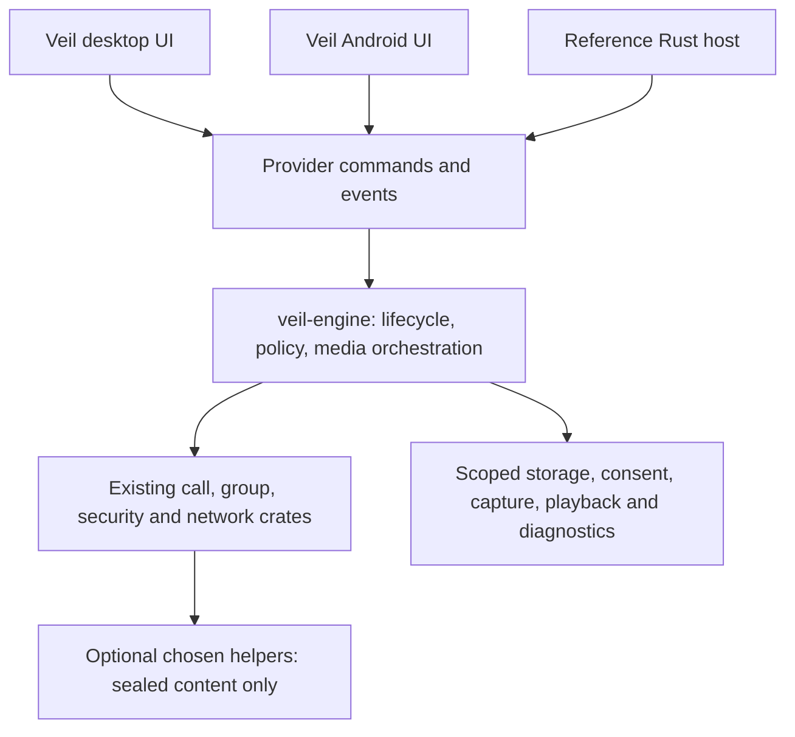

# One headless engine supplies standalone and embedded calls

Status: accepted engineering design for SDK-02 (23 November 2026).
This records implementation decisions within the agreed Modular, Agnostic, Shared mission.
The public Rust surface below is **proposed**, not implemented or stable. A maintainer may
revise this ADR before extraction; it is not a claim of external review or host integration.

## Context and decision

`veil-call`, `veil-group`, `veil-net`, `veil-security`, `veil-media` and the helper libraries
already implement shared protocol and media capabilities. The higher-level orchestration is
private in `veil-app::engine`. Android's library launcher opens that application; exposing
`run_android` does not make a headless SDK.

Extract the orchestration into a new `veil-engine` library. Desktop, Android and a non-GUI
example must all use it. Keep UI state/rendering in `veil-app`; do not export `Engine::sync`,
egui contexts, the current `model::Call`, raw `EpochKeys` or private device keys as the
provider interface. Preserve the existing wire protocol during extraction.

Start with **native Rust in one trusted host process**. A local authenticated bridge is a
later BIND-01 adapter over this contract. Browser media/runtime support, a universal widget,
and replacing Discord/Slack native calls need separate feasibility work. Named host examples
express intended journeys, not permission or proof that their extension APIs support them.

## Ownership and allowed access

| Owner | Owns / can access | Boundary |
|---|---|---|
| Engine/core | Session identity instance, MLS group/epoch state, frame keys/counters, invitations, admitted roster, routing, replay checks, workers and bounded queues | No host command injects a roster, marks itself admitted, installs epoch keys, bypasses pinning, or restores removed membership |
| Host application | Authorised start/join/leave and local media intent; public identities, safety codes, roster, connection/media state, received plaintext media/chat, explicitly requested invitations | A display name/account match never proves a Veil identity. Host account tokens/contacts are not uploaded to helpers |
| Platform adapters | User-visible OS permission/consent flow, authorised raw camera/mic/screen input, playback/output surfaces and scoped encrypted storage | An adapter receives only the data needed for its role; no network membership or route-policy authority |
| Chosen helper | Existing bounded routing/registration/forwarding state and sealed frames | No conversation keys or plaintext media |

An in-process host can inspect process memory and plaintext by design. Private Rust fields
limit accidental API exposure; they do not isolate secrets from a malicious host or native
plugin. A host supplying capture/playback also sees that plaintext. BIND-01 must specify its
different caller authentication and process boundary rather than promising isolation here.

Default identity scope is one installed host application and OS user/profile. Veil standalone
and another app do not silently share a key or verified contacts. `StorageScope` is selected
once when the provider opens, derived from trusted installation/profile configuration, and
cannot be changed through a call command. A future local bridge derives it from authenticated
caller identity, not a client-supplied directory. Sharing an existing identity requires a
separate explicit custody/consent design. Display-name mapping is local host metadata.

`IdentityStore` opens/saves the engine's protected identity record and local verification
records with distinct authenticated purpose labels; OS Keystore/DPAPI calls stay in native
adapters. The provider exposes public identity and store health, not export of the secret.
Missing first-use storage can create a key. An existing unreadable identity produces
`IdentityUnavailable`; normal start cannot silently replace it. An explicit reset flow warns
that prior verification changes. This is a required improvement over the current app's
set-aside-and-regenerate recovery, not a description of current behaviour.

## Runtime and session lifecycle

`Provider::open(scope, adapters, limits)` owns one engine runtime (initially a dedicated Tokio
runtime and bounded native workers) independent of egui, Activity, or a host's async executor.
Sharing an external executor is deferred until its shutdown contract is tested. No global
app configuration, environment lookup, updater or GUI event loop is needed by this library.

First extraction supports one starting/active call per Provider. A process-wide platform
media arbiter prevents independent Providers from silently opening the same capture device;
failure is `DeviceBusy`. Separate-process device ownership follows OS rules. Expanding call
concurrency is a later resource-policy change, not implicit support from cloning a handle.

1. `open` loads scoped identity/trust and reports readiness/storage failures; it does not
   open a microphone, camera, screen, network listener, or discovery advertiser.
2. `prepare` selects devices, output preferences and immutable validated network policy.
   Preview capture requires its own explicit consent, independently of joining.
3. `create` / `join` returns a session handle promptly in `Starting`; all DNS, short-invite
   fetch, binding, helper registration, dialing and lobby waiting remain cancellable.
4. Host startup reaches `Hosting`; a guest reaches `WaitingForAdmission` only after its
   authenticated knock reaches the host. `Admitted` means current cryptographic membership,
   not proof of delivered media. Per-peer media reachability is reported separately.
5. `Reconnecting` refers to bounded recovery of the same authorised identity/session.
   The current recovery protocol still checks removal, current roster and replay bounds;
   no fallback fresh-admits or restores an old key epoch. Host restart ends the call.
6. `leave`/`cancel`/provider shutdown revoke capture grants and detach all outbound taps
   immediately, then close links, helper registrations/mappings and workers. `Ending` rejects
   new work. `Ended` includes a final reason and cleanup result; that session never revives.

All handles include a provider instance and session generation; participant handles are
opaque generation-bound handles tied internally to a device key, never bare UI/MLS indexes.
Lobby decisions additionally name a knock instance. Reused leaf indexes, delayed UI actions,
device switches and stale callbacks cannot address a new session/person. Rejoin after an
ended call is an explicit new session and uses current invitation/admission rules.

Shutdown is explicit and awaitable. Default proposed deadlines are 2 seconds for graceful
network close and 3 seconds total before returning `CleanupIncomplete` with resource kinds.
An unfinished device worker is quarantined: taps remain revoked, late media is discarded,
new capture for that device is refused until release, and completion is observed separately.
No API claims a timed-out OS driver thread was killed or capture certainly stopped. Provider
Drop requests stop without blocking a host UI indefinitely; it is not evidence of complete
cleanup. The standalone host awaits shutdown at lifecycle boundaries wherever the OS allows.
Android's current process-kill teardown is a standalone preview workaround, not SDK policy.

## Commands, acknowledgements and events

These are conceptual names, not callable APIs shipped in this milestone:

| Request | Preconditions / engine action | Observable completion |
|---|---|---|
| Create / Join | Validate policy/invite, load scoped identity, open permitted network paths | Session state progresses or a typed failure; guest admission remains explicit |
| Admit / Decline | Host role, live matching knock and participant handle | Accepted request ID, then applied/rejected result and actual lobby/roster transition |
| Remove | Host role, current member; protocol commits revocation | Membership/epoch change or rejection; removed identity cannot recover |
| Set microphone/camera/screen/share sound | Current session, user consent and OS permission, current device generation | Requested, starting, active, stopped or failed media state; mute revokes source taps first |
| Set playback / select device | Authorised local choice; exclusive device lease and replacement validation | Actual route/device state; a failed switch is visible rather than reported as successful |
| Send chat / react / raise hand | Current admitted membership and protocol size/rate limits | Correlated local send result; no invented remote delivery/read receipt |
| Verify / forget | Exact public device identity and comparison challenge from current snapshot | Scoped local trust persisted or a storage error; verification never admits a person |
| Receive demand | Admitted peer stream handles and supported media capabilities | Applied effective demand/capability result; true zero-video waits for DATA-01 support |
| Request invitation | Host authorisation; existing expiry/single-use and admission semantics | Sensitive invitation available only to requesting local host; omitted from routine logs |
| Leave / cancel | Valid session, any lifecycle state | Idempotent stop acknowledgement, terminal reason and explicit cleanup result |

`try_command` validates lengths/handle scope and reserves a completion slot before accepting
a monotonically identified request. Queue admission is not protocol success. Exactly one
applied/rejected/cancelled completion is retained for each accepted ID. Queue-full rejection
is synchronous and accepts no work. Leave/cancel uses an independent stop flag/token and
cannot be blocked by a full ordinary command queue. A cancelled request that already applied
is reported applied; the following shutdown/revocation is a separate observable transition.

One session actor serialises authoritative state changes and assigns increasing sequence
numbers to events. Request completions carry their request ID and state sequence. Committed
membership/epoch state precedes any media offered for that membership. Stale-generation
events are discarded before adapter/UI effects. No state/media follows the terminal sequence.

Resource defaults proposed for extraction (must be measured in SDK-02, not current guarantees):

| Resource | Initial bound / behaviour |
|---|---|
| Outstanding commands/completions | 64 reserved request slots; reject `Busy` before accepting a 65th |
| Ordered non-coalescible events | 128 records, 1 MiB total; no unbounded membership/chat queue |
| State/stats | One latest versioned snapshot; include sequence and changed-field versions |
| Decoded video | Latest frame per active stream; max 2 streams/member, supported roster cap, 64 MiB aggregate; refuse/drop before allocating beyond budget |
| Capture/encoding | One queued raw frame per source, 8 audio frames, 32 encoded packets plus byte caps; late media drops, never blocks network control |
| Keyframe requests | One pending bit per permitted peer/stream; coalesce requests |
| Incoming control/media | Existing protocol limits plus explicit engine byte/age budgets; admission/refusal and overload are visible |

If critical events cannot fit, close with `ConsumerTooSlow`; never silently lose removal or
grow memory. A reserved terminal record/final snapshot remains readable independently of the
full queue, and outstanding request slots retain their terminal completion results. Cleanup
does not wait for the consumer. Polling drains ordered events before the terminal record;
the final snapshot exposes the last sequence and any coalesced/gap range. Returning a
completion frees its request slot; hosts that never read results eventually get `Busy`.

Video/audio outputs use bounded sinks that cannot call back into the actor while it holds
locks. Deliver immutable owned buffers with dimensions, format, timestamps and stream handle;
no egui textures. A slow renderer drops old pictures. Decoded plaintext is delivered only
after authentication/replay and codec checks. Host-provided capture is validated for size,
format, timestamp bounds and consent generation before encoding/sealing.

## Consent, policy and errors

`ConsentBroker`/`CaptureFactory` are trusted platform capabilities. The host requests capture
through an explicit user action; the platform reports OS permission and a grant bound to
scope, session/source, device generation and lifetime. A boolean passed to `join` is not a
capture grant. Grant/revoke callbacks are asynchronous and cancellation-safe; late grants
cannot restart a muted/ended session. Changing devices or screen sources needs an authorised
replacement. Share sound (planned, [ADR 0007](0007-share-sound-is-a-separate-opt-in-stream.md))
is its own capture source with its own grant; a screen grant does not include it. Permission
denial permits receive-only joining; it must not auto-enable another source. Background policy can stop video while leaving permitted audio independently active.
A native trusted host can implement a dishonest broker; this design does not sandbox it.

Network policy is an immutable session snapshot. Local only rejects relay-only conflicts,
skips internet DNS/helper/update/mapping work and enforces the on-link transport boundary.
Hide my address never probes a direct path to improve connectivity. No default helper or
helper substitution is added. Policy widening requires a new explicit session/consent flow;
temporary recovery never widens it. Discovery remains opt-in and advertises only while its
scoped lease is active. Full invitations still work without short-link/discovery services.

| Error family | Examples / host response |
|---|---|
| Input / unsupported | Invalid/expired invitation, invalid policy, unsupported runtime/media feature; fix input or show capability boundary |
| Authorisation / trust | Guest requested host-only action, unknown knock, wrong pinned key, removed/revoked member; do not retry by relaxing checks |
| Permission / device | Capture denied/revoked, device busy/lost, background disallowed; show actual local media state and allow receive-only |
| Storage / identity | Store unavailable/corrupt, verification write failed; explain stable identity/trust impact, require explicit reset if needed |
| Connectivity | No permitted route, DNS timeout, chosen helper refused/unavailable; bounded retry under unchanged policy |
| Resource / consumer | Busy, limits exceeded, ConsumerTooSlow, adapter too slow; reject or terminate with bounded resources |
| Lifecycle / internal | Cancelled, stale handle, session ended, CleanupIncomplete, internal failure; preserve correlation and cleanup outcome |

Errors expose stable codes, stage, retryability under the same policy and safe display text.
Underlying library diagnostics are local/redacted and opt-in to export; no invite secret,
keys, message content or OS device IDs in normal events/logs. Public peer identities and
routes needed by the authorised local host remain sensitive metadata, not telemetry.

## Traceable host journeys

| Journey | Contract trace and trust check |
|---|---|
| Create/admit | Host opens scoped Provider → create with Local only → Hosting → explicit invite request → authenticated lobby knock → host Admit(knock) → applied completion → committed roster → per-peer media readiness |
| Join/mute | Guest parses full invite → join without capture → WaitingForAdmission → Admitted → authorised microphone grant → active → mute revokes taps → stopped; neither admission nor permission is inferred from a UI label |
| Verify | Host/guest shows exact device safety challenge → user compares over trusted channel → Verify(challenge, identity) → store completion → local verified label; changed device key needs new comparison |
| Reconnect/remove | Connection drops → Reconnecting → host removes device and commits revocation → stale resume fails → Ended(Removed); no recovery event changes the revoked roster |
| End/unload | Host plugin requests shutdown while dialing/live → cancellation wins over late callbacks → Ending → taps revoked/links closed → Ended(reason, cleanup); plugin waits or shows incomplete cleanup before unloading native code |

Mailcraft-style example: a conversation's Call button obtains an explicit invite/start
action and opens a scoped provider; a locally authenticated conversation participant is
still a Veil lobby applicant until admitted. The host renders its own roster/media and
compares safety codes; unloading its plugin awaits provider shutdown. No access to a
Mailcraft repository or an actual adapter is assumed or claimed by this walkthrough.

## Migration and completion evidence

The [source inventory](../ENGINE_PROVIDER_INVENTORY.md) maps every engine module and its
app dependencies to the extraction destination. Sequence implementation as follows:

1. Introduce toolkit-free value types, typed errors and runtime/lifecycle owner behind a
   private prototype. Add bounded commands/events, stop token and generation handles first.
2. Move shared host/guest/session orchestration and protocol/policy helpers without changing
   wire formats. Bound the underlying `veil-call` host/member event producers and temporary
   join buffers too; a bounded outer SDK wrapper around unbounded internals is insufficient.
3. Inject scoped storage, consent/capture/playback, discovery and redacted diagnostics.
   Keep codec/native implementations in their existing crates. Add deterministic fake
   adapters for cancellation, queue saturation, stale callbacks and failure testing.
4. Migrate standalone desktop through a thin snapshot/event → `model::Call`/egui adapter;
   keep updater, system fonts, textures, firewall/admin prompts and saved setup UI in the app.
5. Migrate Android through the same provider, with Activity-independent adapter ownership;
   make the standalone launcher own its OS lifecycle policy. Validate denied permissions,
   pause/resume, destroyed Activity and background audio on hardware; do not put process kill
   into `veil-engine`.
6. Build a documented non-GUI `examples/headless-call` host: explicit configured identity
   scope/policy, manual approve/decline, console safety comparison, consent-authorised real
   audio/video and awaitable shutdown. Also build it as an external project from a pinned
   Git revision using public APIs only. No test auto-admit policy becomes a product default.

SDK-01 is the design/traceability gate. SDK-02 proves implementation: compatible standalone
interop, create/join/admit/mute/verify/reconnect/end, cancellation at every stage, saturation,
adapter/store failures, repeated start/stop without orphan tasks/ports/capture, and external
consumer acquisition/build. Benchmark media/event memory and tune the proposed bounds using
measured supported devices. TRUST-01's malicious forwarded-member attribution gap remains a
separate prerequisite for broad group safety claims; extraction must not relabel it fixed.

## Alternatives and consequences

- Exporting the app engine would expose egui models, storage globals and unbounded commands;
  it would make every host inherit standalone lifecycle assumptions. Rejected.
- Duplicating the engine/protocol per host would lose one shared interoperability/security
  path. Rejected.
- A bridge-first implementation adds caller authentication, IPC and media-copy costs before
  the native contract is proven. Deferred to BIND-01, using this same engine.
- Replacing the transport is independent research and would make this extraction harder to
  verify. Keep current transports and pinned identities.

The cost is an explicit adapter boundary and migration effort, plus deliberate tightening of
current storage, cancellation and queue semantics. The benefit is one owned, testable call
lifecycle for standalone and host applications without weakening admission or key custody.
